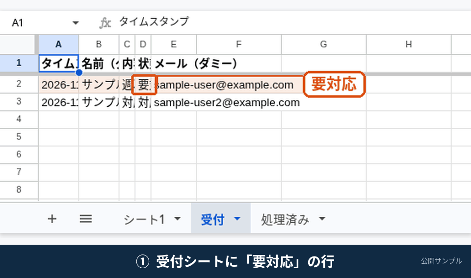

# gas-sheet-transfer-notify

フォームやシートの増分を転記し、必要なら通知します。



上のGIFは、デモ用アカウントでの実操作です。顧客の本番環境の画面ではありません。通知先などの個人情報は伏せています。処理前後の比較は [docs/screenshots/form-transfer-before-after.png](docs/screenshots/form-transfer-before-after.png) にあります。

Google スプレッドシートの「受付」で、状態が **要対応** の行を「処理済み」へ転記し、自分のテスト用アドレスへメールを **1通** 送る、Google Apps Script（GAS）のサンプルです。

**これは公開用のサンプルであり、受注成果物ではありません。** 実在の顧客データ、ログイン情報、API キーは含まれていません。

出品「スプレッドシートをGASで自動化します」の完成イメージ（トリガー1つ＋処理1つ）を、新しい Google アカウントでも15分程度で再現できるようにしたものです。

デモ用アカウントで、このサンプルと同じロジックを `setupOnce` から `testProcessFirstNeed` まで実行して確認しています。コードは GAS の制約（インストール可能なトリガー、メール権限、同時実行のロック、失敗時の巻き戻し）を踏まえて書いてあります。初回は必ず `testProcessFirstNeed` で、自分のシートとメールを確認してください。

## できること

- 状態が `要対応` の行を、「処理済み」シートの最終行へコピーする
- スクリプト プロパティ `NOTIFY_TO` のテスト用アドレスへ、決まった件名・本文のメールを1通送る
- 元の行の状態を `転記済` にして、同じ行を二重に処理しない
- 列の位置が変わっても、**1行目のヘッダー名** で列を探す
- メール送信や転記に失敗した場合は、状態を元に戻し、途中まで書いた「処理済み」の行を削除する

## できないこと（このサンプルの範囲外）

- LINE / Slack など外部サービスへの通知
- 有料 API との連携
- 複数の条件分岐が絡む業務システム
- 24時間の監視や、障害の常時対応

## 15分で再現する手順

Google アカウント（個人の無料アカウントで可）で進めます。Workspace 固有の設定は不要です。

### 1. スプレッドシートを用意する

1. [Google スプレッドシート](https://sheets.google.com/) で新しいブックを作る
2. 拡張機能 > **Apps Script** を開く
3. このリポジトリの `src/Code.gs` の内容を、エディタのコードに貼り付ける（既存の `function myFunction` は消してよい）
4. `src/appsscript.json` がある場合、エディタ左の「プロジェクトの設定」で `appsscript.json` を表示し、中身を合わせる。分からなければ、初回実行時に求められる権限で進めてもよい
5. プロジェクトを保存する

clasp を使う場合は、末尾の「clasp で使う場合」を参照してください。初めてなら、上のコピー＆ペーストの方が早いです。

### 2. シートとダミー行を作る

1. エディタ上部の関数名で `setupOnce` を選び、実行する
2. 初回は権限の確認が出る。自分のアカウントで、シートの編集とメール送信を許可する
3. ブックに「受付」「処理済み」シートと、ダミー2行ができる（詳しい列は [docs/sheet-layout.md](docs/sheet-layout.md)）

すでに同名シートがある場合、中身は上書きしません。ヘッダーが違うときだけ、手動で1行目を合わせてください。

### 3. 通知先を自分のメールにする

1. Apps Script の「プロジェクトの設定」（歯車アイコン）
2. **スクリプト プロパティ** に次を追加する

| プロパティ | 値 |
| --- | --- |
| `NOTIFY_TO` | **自分で受け取れるテスト用メールアドレス** |

`example.com` などのダミーアドレスを指定しないでください。届かず、エラーになります。

### 4. トリガーなしで1回試す

1. 関数 `testProcessFirstNeed` を実行する
2. 「受付」の2行目（要対応だった行）の状態が `転記済` になる
3. 「処理済み」に同じ内容が1行増える
4. `NOTIFY_TO` のアドレスに、件名 `【サンプル】新しい要対応行を転記しました` のメールが1通届く

ここまで動けば、コアの処理は確認できています。

### 5. 編集をきっかけに動かす（このサンプルの標準）

このサンプルの標準トリガーは **インストール可能な「編集時」** です。単純な `onEdit` ではメールが送れません。

1. Apps Script の左メニュー「トリガー」（時計アイコン）
2. トリガーを追加
3. 次のように設定する

| 項目 | 値 |
| --- | --- |
| 実行する関数 | `handleEdit` |
| イベントのソース | スプレッドシートから |
| イベントの種類 | 編集時 |

4. 保存する（再度、権限確認が出ることがある）
5. 「受付」の3行目の状態を `対応不要` から `要対応` に変える
6. 数秒待ち、転記とメールを確認する

状態が `転記済` の行を編集しても、再送しません。

### フォーム送信に切り替える場合

Google フォームの回答を、このスプレッドシートに記録するようにします。質問名はシートのヘッダーと揃えます。「状態」質問が無いときは、新しい行の状態は空になり、スクリプトはそれを `要対応` とみなします。

1. 先の `handleEdit` トリガーが不要なら削除する（両方残すと、同じ行を二度見ることがあります。状態のガードはあるので二重送信はしませんが、標準はどちらか一方です）
2. 新しいトリガーを追加する

| 項目 | 値 |
| --- | --- |
| 実行する関数 | `handleFormSubmit` |
| イベントのソース | スプレッドシートから |
| イベントの種類 | フォーム送信時 |

## 失敗したときの見方

- 実行ログ: Apps Script の「実行数」。シート名の誤り、`NOTIFY_TO` 未設定、権限不足は、エラーメッセージに日本語で出します
- 権限: メールが送れないときは、単純トリガーになっていないか、メール送信の許可が落ちていないかを見る
- 途中失敗: 転記やメールが失敗すると、状態を元に戻し、追加した「処理済み」行を削除します。残った場合はログの `rollback` を確認する

## 画面の説明図

実際の Google 管理画面を撮影したものではありません。列の見え方と、処理前後の違いを説明する図です。

- [docs/screenshots/intake-before.png](docs/screenshots/intake-before.png) … 処理前の「受付」
- [docs/screenshots/done-after.png](docs/screenshots/done-after.png) … 処理後の「処理済み」
- [docs/screenshots/email-example.png](docs/screenshots/email-example.png) … 通知メールの例
- [docs/screenshots/trigger-settings.png](docs/screenshots/trigger-settings.png) … 編集時トリガーの設定項目

作り方のメモは [docs/screenshots/README.md](docs/screenshots/README.md) にあります。

## clasp で使う場合（任意）

```bash
npm install -g @google/clasp
cp .clasp.json.example .clasp.json
# .clasp.json の scriptId を、Apps Script プロジェクトの ID に書き換える
clasp login
clasp push
```

標準の手順は、スプレッドシートにバインドしたスクリプトです。`CONFIG.SPREADSHEET_ID` を使うスタンドアロンにする場合は、`src/appsscript.json` の `spreadsheets.currentonly` を `https://www.googleapis.com/auth/spreadsheets` に広げてください。

## ライセンス

MIT License（`LICENSE` を参照）。
